# Cherry Pick

A [Stash](https://github.com/stashapp/stash) plugin that learns what you like from your own ratings and plays, and shows it inside Stash's pages: a For you row on the front page, or one scene ready to play in its place, Your score on scenes you haven't rated, More like this on scene pages, and performer and scene brackets that sharpen what it learns. It needs no account and no setup. A StashDB key, if you have one in Stash, adds popularity and the scenes you don't have.

Cherry Pick 0.2.2 is built and tested on Stash v0.31.1.

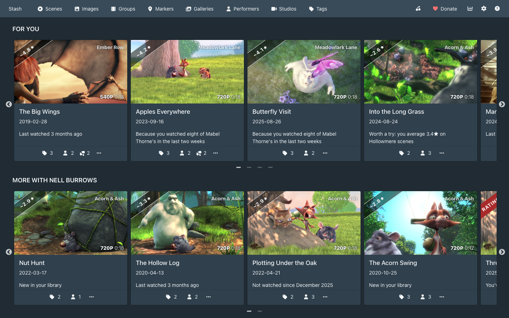

## Install

Cherry Pick comes from the CandyBoudoir plugin source, which carries every CandyBoudoir plugin.

1. In Stash, open Settings > Plugins > Available Plugins and click Add source.
2. Fill in the source:
   - Name: `CandyBoudoir`
   - Source URL: `https://candyboudoir.github.io/index.yml`
   - Local path: `candyboudoir`
3. Expand the CandyBoudoir source, tick Cherry Pick and click Install, then refresh the page.

If you run a Stash develop build, use `https://candyboudoir.github.io/develop/index.yml` as the source URL instead. Add one of the two sources, never both: they carry the same plugins.

Cherry Pick works with any theme, CandyBoudoir's own included: it uses Stash's own cards, rows, buttons and dialogs, and its CSS sets only layout.

## What it adds

Everything sits inside Stash's own pages. There is no new tab.

| Where                       | What                                                                                                                                                                                                                                                                                                                                                                                                                                                                                                                                                                                                                                                                                                                   |
| --------------------------- | ---------------------------------------------------------------------------------------------------------------------------------------------------------------------------------------------------------------------------------------------------------------------------------------------------------------------------------------------------------------------------------------------------------------------------------------------------------------------------------------------------------------------------------------------------------------------------------------------------------------------------------------------------------------------------------------------------------------------- |
| Front page                  | **For you** comes first: 12 scenes you own, ranked by your taste, what you have watched in the last two weeks, how long since you last played each one, and a little variety. Scenes you have already seen come back only if you tend to rewatch; if you rarely do, For you sticks to scenes you haven't played. Each card says why it is there. Up to two rows follow when your recent watching calls for them ("More with ...", "Back to ..."), then the **Hall of Fame** of your bracket champions, then Stash's own rows. The rows are worked out when you open the front page and hold still while it is open. With **Watch This** on, one scene ready to play takes the place of Cherry Pick's rows (see below). |
| Scene cards                 | **Your score** in the rating corner of scenes you haven't rated ("~4.4★"), with the reason on hover.                                                                                                                                                                                                                                                                                                                                                                                                                                                                                                                                                                                                                   |
| Scene page                  | "likely 4★ for you" beside the stars, with the reason, and **More like this** under the player: scenes in your library you have barely played, then, with a StashDB key, scenes you don't have.                                                                                                                                                                                                                                                                                                                                                                                                                                                                                                                        |
| Performer page              | A **For you** line in the details ("You average 4.9★ on her scenes · 3× champion"), and, with a StashDB key, their scenes you don't have after their scene list.                                                                                                                                                                                                                                                                                                                                                                                                                                                                                                                                                       |
| Performer cards             | A trophy for bracket champions who won a Challenge round, a crown for other champions and a medal for finalists.                                                                                                                                                                                                                                                                                                                                                                                                                                                                                                                                                                                                       |
| Performers and Scenes lists | **Bracket** and **Options**, beside the list's toolbar.                                                                                                                                                                                                                                                                                                                                                                                                                                                                                                                                                                                                                                                                |
| Navbar                      | A pair of cherries that opens Cherry Pick's page: how accurate Your score is, the full Hall of Fame, StashDB, what you have hidden, and Remove Cherry Pick data.                                                                                                                                                                                                                                                                                                                                                                                                                                                                                                                                                       |

Cards in Cherry Pick's rows have a menu with **Not interested**, which hides the card and shows less of what put it there, and **Don't learn from this**, which keeps a scene's plays, rating and bracket picks out of what Cherry Pick learns. Don't learn is also beside the stars on the scene page.

Nothing appears while a scene plays. Once you press play, every Cherry Pick piece on the page steps out until you leave it.

The first time a browser opens Stash with Cherry Pick, For you's header says how far it has got reading your library and learning your taste, about 6 seconds on a library of 25,000 scenes. Later visits start from the browser's copy and take about 2 to 3 seconds.

| Scene page                                                                         | More like this                                                                               |
| ---------------------------------------------------------------------------------- | -------------------------------------------------------------------------------------------- |
| 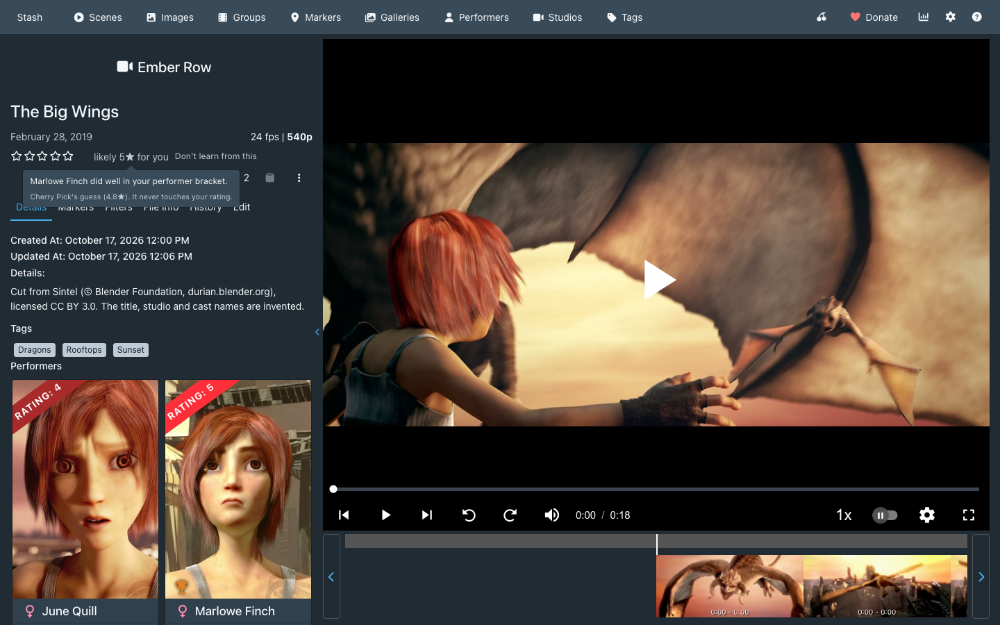 | 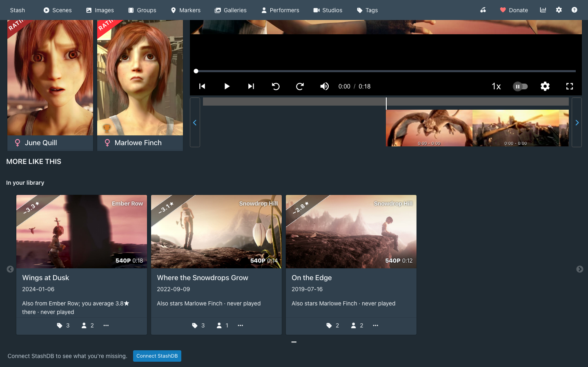 |
| **Performer page**                                                                 | **Cherry Pick's page**                                                                       |
| 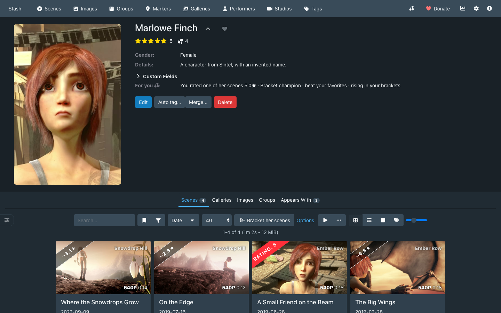       | 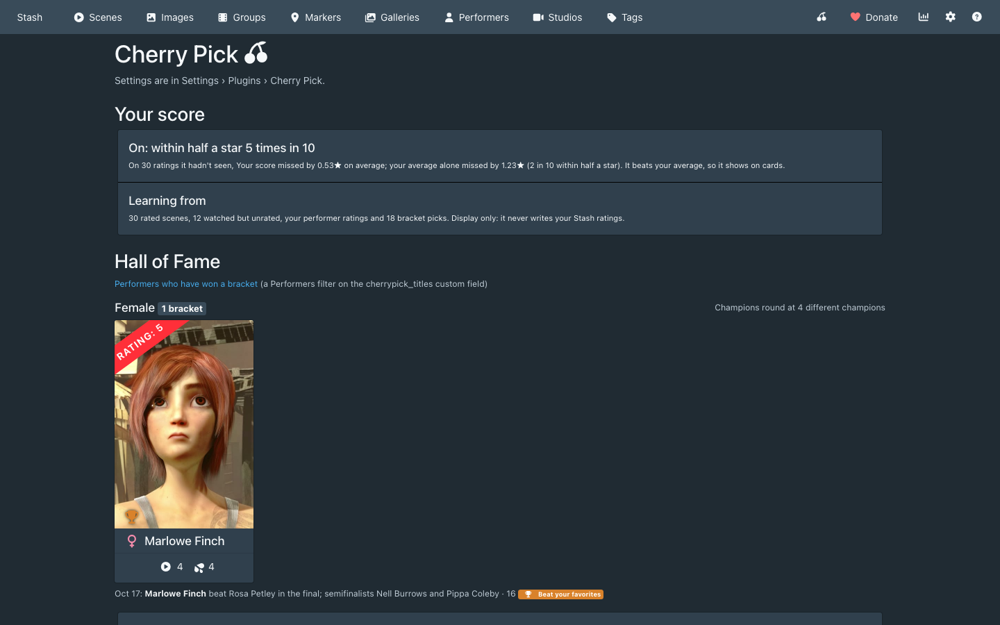              |

### Watch This

Watch This is for the visits when you'd rather not choose. Turn it on in Cherry Pick's settings and its front-page rows give way to one scene, the one with video that For you ranks highest, in Stash's own player across the page. Stash's own rows stay below it.

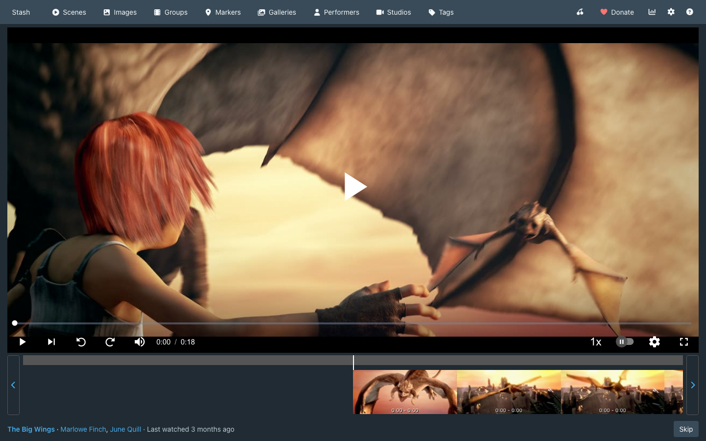

The player is Stash's, so the scene plays as on its own page: Stash records the play and where you stopped, its Auto-start video setting decides whether the scene starts by itself, and Space or Enter plays it with no click, since the player takes the keyboard when the scene loads (↑ and ↓ then set the volume until you click elsewhere). The line under the player names the scene and its performers and says why Cherry Pick picked it. Once the scene plays, the line steps out and nothing of Cherry Pick's appears until you leave the page. When the scene ends, nothing happens.

Skip, in the line, as the player's next button or with the next-track media key, means you aren't in the mood for that scene: it sleeps for 48 hours and the next pick shows, one that shares no performer with the scenes you skipped this visit. Skipped again with no play in between, it sleeps for a week, then for 30 days each time; once you play it, the next skip is back to 48 hours. A Skip after playing at least a tenth of the scene counts as having watched it, so the scene sleeps 48 hours again; a shorter look before Skip doesn't count as a play. Back, in the line or as the player's previous button after a skip, brings the last skipped scene back with its sleep as it was. A pick left on screen without being played or skipped sleeps as if skipped once that has happened on three different days. Skips change nothing Cherry Pick has learned: no rating, no Not interested and nothing For you counts. They are kept in Stash's plugin configuration, so they hold on every device.

Audio-only files and scenes without a file never play. In a library under 30 scenes, the pick is the one New in your library would show first.

### Your score

Your score is learned in your browser from your Stash ratings, from how you watch (how much of a scene you play, how often you come back to it, and its O count), and from your bracket picks. A play counts as far as the time behind it: each tenth of a scene's length played pays for one play, so a scene played for less than a tenth in all, such as one swiped past in Stash TV, teaches Cherry Pick nothing, and For you treats it as not watched yet. Your score shows only once it predicts your ratings better than your average rating does, which Cherry Pick checks on ratings it set aside. It is display only: it never changes your Stash ratings.

Your score needs 10 rated scenes before it can check itself. Until then, For you's header, the scene page beside the stars and Cherry Pick's page say how many ratings are left, and For you ranks by the performers you favorite or rate in Stash, your bracket picks and what you have played. The weight on favorites and performer ratings fades as your scene ratings arrive and is gone at 10.

### Brackets

Bracket on the Performers list starts a 16-performer, single-elimination bracket in one click, from the performers in your library with a photo and a scene, of your library's largest gender or the one the list is filtered to. Options picks the gender, 16, 32 or 64, and the pool (your library, favorites, or the list's current filter). When a gender's pool is short, Set genders lets you set missing genders in Stash with a tap; Cherry Pick never guesses one. Bracket on the Scenes list, or "Bracket her scenes" on a performer page, does the same with every scene you own, watched or not, leaving out audio-only files and scenes marked Don't learn from this. Scenes you have rated sit out while four unrated ones can play, and a pool under 16 plays every unrated scene, with byes.

Each side of a scene match shows the scene's cover and eight frames spread over its length, its studio, year, length and resolution, up to four performers' faces and a row of tags, so you can judge a scene you have never watched. A click or a tap on the cover picks it, and so does Pick this. A frame opens one scene large at that moment, and Look closer (1 or 2 on the keyboard) opens it on the cover: step through its frames with the arrow keys or the buttons, scrub along the bar, play its preview, and read every performer, the description and every tag. There Enter picks, O switches to the other scene and Esc goes back to the match. The frames and the preview are the sprite sheet and preview clip Stash generated, so they work whatever the scene's format; the preview plays muted unless Stash is set to play sound on previews. Nothing in a bracket plays a scene's own file or records a play. A scene Stash has no previews for shows its cover and details and says so; Stash's Generate task, with previews and sprites ticked, makes them. A second pick within 400 ms of the last is ignored, so a double tap can't also pick in the next match.

Pick with a click, a tap or the arrow keys: U undoes, Esc pauses, and a paused bracket waits for you, even after a reload. Every pick teaches the model. When a performer bracket ends, the champion, finalist, semifinalists and quarterfinalists get three custom fields on their Stash record (`cherrypick_titles`, `cherrypick_best_finish`, `cherrypick_last_bracket`), which Stash shows on the performer page and can filter on. Four different champions of one gender unlock a Champions round.

A bracket's job is to add ratings for Cherry Pick to learn from and to turn up performers and scenes you don't know well yet. Its places go to the ones you haven't rated, picked across the range of what Cherry Pick expects you to think of them. People rate their favorites, and a rated favorite would win its way to most finals, so the ones you have rated play only when there aren't enough unrated ones to fill the bracket; each then meets an unrated one in the first round. The others meet across the bracket's halves in the first round: of 16, the one Cherry Pick rates highest meets the ninth, the second the tenth, and so on, so the strongest don't knock each other out before every one is rated from where it finished. Performers and scenes from your last three brackets of the same kind (and gender) sit out while others can take their places. No card shows a rating, a seed or a reason drawn from your ratings, so your earlier ratings don't steer your picks.

When the champion has no rating of yours, the champion screen offers an optional Challenge round, Test the champion. The champion meets up to three performers or scenes you have rated that didn't play in the bracket (of the same gender, for performers), the ones from the list the bracket came from first, picked across your stars and met lowest rated first, so your highest rated comes last. A loss ends the round. A champion that beats every one gets a trophy in place of the crown on its performer card, "beat your favorites" in its For you line and a mark in the Hall of Fame. Rate them myself skips the round and asks for the champion's stars instead.

In a performer bracket, a performer you haven't rated who is in two or more scenes you have rated counts as rated, at the average of those scene ratings: two scenes at 4★ and 3.5★ make 3.75★. Your performer brackets then have ratings to measure against when you rate scenes and leave performers unrated. Performers you rated yourself come first, in a bracket's places and in the Challenge round, and performers counted from their scenes fill what is left. Only your own scene ratings count, so ratings Ascension, HotOrNot, Xenith, Restash or Ascension's Prime set, provisional ratings and scenes marked Don't learn from this are left out.

"Apply to my ratings" then offers a Stash rating for every unrated one that played, first-round losers included. Each comes from where it finished: a bracket's places are spread over what Cherry Pick expects you to think of your library, so its finishing order is laid over your own ratings. In a 16-place bracket drawn from your whole library the champion gets about the rating of your top sixteenth and the last place about your bottom sixteenth, and a bracket of one performer's scenes sits where those scenes sit in your library. Within a round, the one that lost to whoever went furthest ranks higher. With fewer than ten ratings of your own, Cherry Pick lays the order over Your score's spread for scenes, or over one to five stars. When the Challenge round places the champion (above your 2.5★ and below your 3.5★ gives 3★, and beating your 5★ gives 5★), or you give the champion's stars yourself, everyone else moves by the same amount. A rated performer or scene that played in the bracket places the ones around it the same way: above your 4★ and below your 4.5★ gives 4.25★, and no one goes above half a star under one that beat them. Ratings from the finish carry a `cherrypick_provisional` custom field, so a later bracket can correct them; once you change one yourself, it is yours. Ratings you gave stay as they are, even one you give while the preview is open: Apply checks each rating again just before it writes. A performer counted from their scenes stays unrated in Stash and counts again in the next bracket, and the preview names where that rating came from: "Cleo Finch (4.0★ from your scene ratings)". Apply shows a preview and has Undo, and changes nothing unless you ask.

With Apply bracket ratings automatically on, under Settings > Plugins, the champion screen has no Apply button: closing it sets those ratings, and says how many first. Cherry Pick's page lists each batch with Undo. The switch starts on, and off while Ascension, HotOrNot, Xenith or Restash's mirror writes your ratings, since their rankings would take up every rating without a preview. It follows those plugins until you set it yourself.

| Playing                                                                   | The champion                                                                                                                     |
| ------------------------------------------------------------------------- | -------------------------------------------------------------------------------------------------------------------------------- |
| 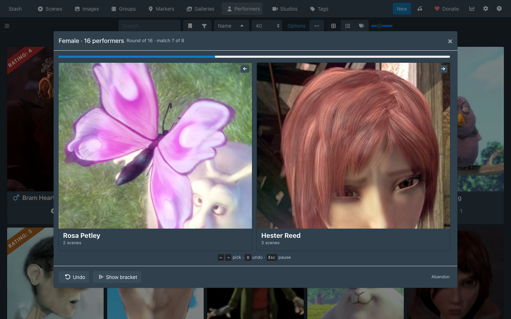 | 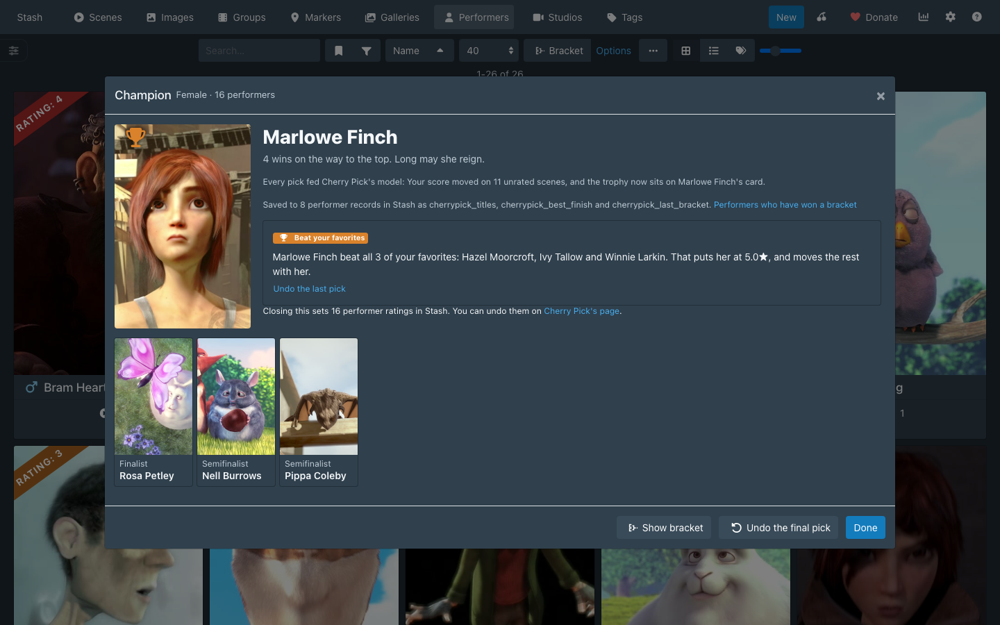 |

| A scene match                                                                                                                       | Look closer                                                                                                                                                           |
| ----------------------------------------------------------------------------------------------------------------------------------- | --------------------------------------------------------------------------------------------------------------------------------------------------------------------- |
| 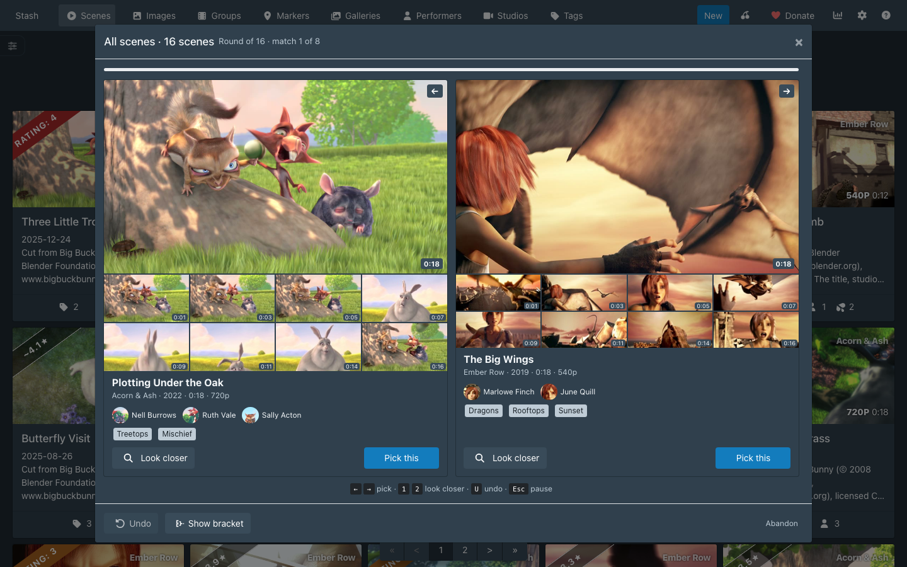 | 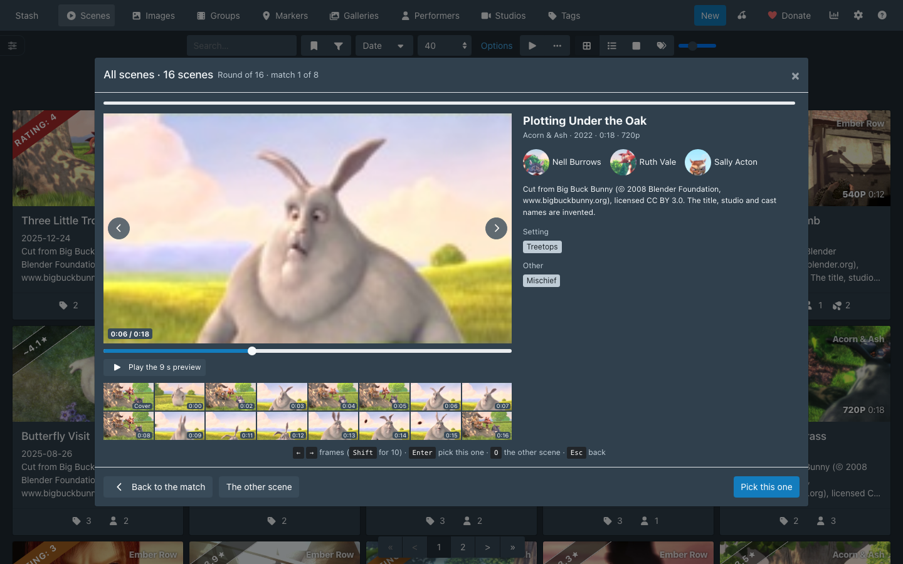 |

### StashDB

With a StashDB key in Settings > Metadata Providers, Cherry Pick uses it straight away and also shows how widely a scene is held, a scene's rank among a performer's scenes, and the scenes you don't have. Without one, where those would show, a Connect StashDB button walks you through getting a key and adds it to Stash's settings for you. Cherry Pick's page can stop the lookups without removing the key.

Each scene you don't have links to where to get it, as StashDB lists it: its page on a clip store or tube (Clips4Sale, iWantClips, ManyVids, Pornhub and the like), named on the button, or else on its studio's site, with tracking codes removed, beside its StashDB page.

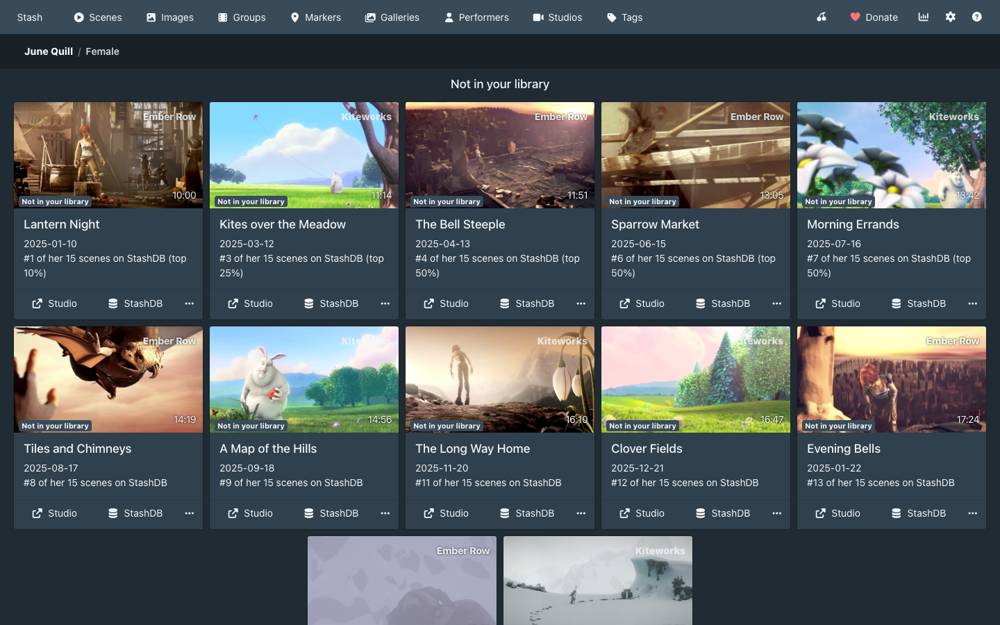

### With Ascension, HotOrNot, Xenith or Restash

Ascension, HotOrNot and Xenith rank performers and scenes by Elo and keep the score in Stash's rating. Restash keeps a score in its own custom fields, and its "Also mirror score to rating100" setting writes that score over Stash's rating too. Cherry Pick reads a rating as yours only when none of these plugins set it. A record carrying Elo match history (the `hotornot_stats`, `elo_matches`, `performer_record`, `scene_record`, `xenith_stats` or `xenith_record` custom field) counts as unrated, and so does a record whose rating equals its `restash_score`. The random starting ratings Ascension's Prime tasks give unrated performers and scenes count as unrated too, and Cherry Pick recognises them by their shape: one value from 1 to 9 shared by most of them, one from 25 to 39, and 40. Your score, For you and the performer lines learn from the ratings you set yourself. A rating you set by hand that equals the record's Restash score reads as Restash's. With Restash's mirror on, every record it scores carries its score, yours included, so Cherry Pick finds none of your ratings there until its Restore Ratings task puts them back. Your score shows on a scene these plugins rated as on one you haven't: on its card, in place of the plugin's rating (Ascension and Xenith already put their own badges there), and beside the stars on its page.

Apply never rates a performer or scene that Ascension, HotOrNot or Xenith ranks or whose rating is Restash's score, and its preview lists them as kept. When Ascension, HotOrNot or Xenith is installed, the preview says it will pick up every rating you apply, since its rankings start from Stash's ratings. Cherry Pick's custom fields sit beside theirs, and Remove Cherry Pick data removes only its own.

Learn from Ascension, HotOrNot and Xenith matches, under Settings > Plugins, teaches Cherry Pick from the games those plugins play. Ascension, HotOrNot_V3 and Xenith keep each performer's and scene's recent matches in a custom field (`performer_record`, `scene_record` or `xenith_record`), and Cherry Pick reads each won or lost match as a bracket pick at half the weight of one of yours, oldest first and ahead of your own picks. Skips, draws and opponents no longer in your library are left out, a match both players recorded counts once, and Don't learn from this keeps a scene's matches out as well. HotOrNot 1.0 and V2 keep only totals, so they add nothing. The switch starts on, and turning it off leaves their matches out. Cherry Pick's page counts the matches it learned from, and a reason names the plugin they came from: "Won 7 of 11 matches in Ascension".

### With Stash Curator

Stash Curator puts its own Appeal score on scene cards, so with both plugins an unrated scene's card carries two predicted scores. When Curator is installed and enabled, Cherry Pick's page and its settings under Settings > Plugins ask once: "Stash Curator also scores your cards. Hide Your score on cards?" Hide on cards turns off Score badges on cards, and Your score stays beside the stars on scene pages. Keep both leaves it on. Cherry Pick remembers the answer and doesn't ask again, and the switch still works by hand. If Score badges on cards is already off, there is nothing to ask.

Bracket on a list filtered by Curator Appeal or Curator affinity leaves that criterion out, since Stash can't filter on it, and says so in the pool's name.

## Tested with

Cherry Pick's tests run on these Stash versions and on Stash's latest develop build, and beside the latest release of each plugin above. A Cherry Pick release waits until every one of them is that plugin's newest, and its release notes name the versions it was tested beside.

| Tested on     | Version       |
| ------------- | ------------- |
| Stash         | v0.31.1       |
| Ascension     | 1.4.1         |
| HotOrNot      | 1.0.0-c4106bf |
| Stash Curator | 0.40.6        |
| Xenith        | 3.2.0         |
| Restash       | 0.3.0-55c1cb2 |

## Settings

Settings > Plugins > Cherry Pick switches each piece on or off. All start on except Watch This and Relative badge style, and Apply bracket ratings automatically starts off beside a plugin that writes your ratings.

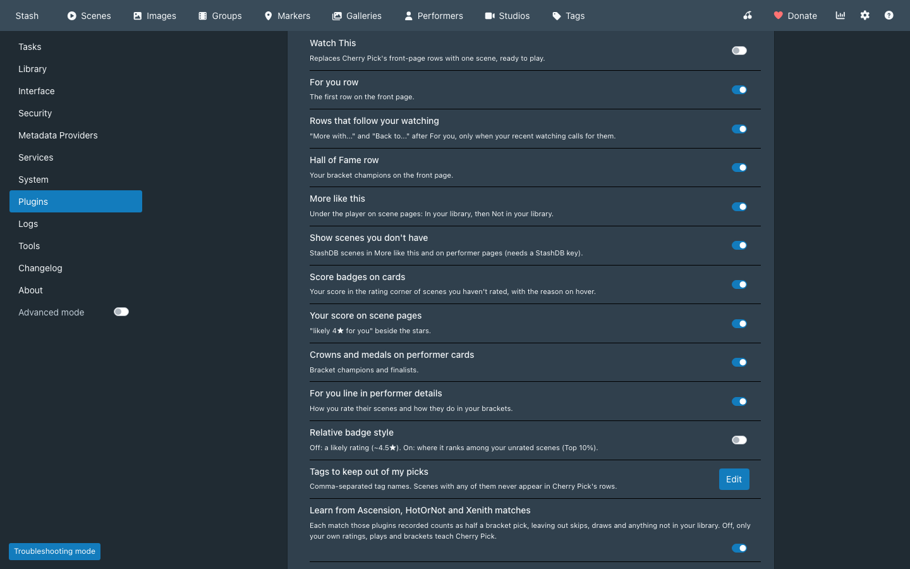

| Setting                                           | Effect                                                                                                                                     |
| ------------------------------------------------- | ------------------------------------------------------------------------------------------------------------------------------------------ |
| Watch This                                        | One scene, ready to play, in place of Cherry Pick's front-page rows. Their switches keep their values.                                     |
| For you row                                       | The first row on the front page.                                                                                                           |
| Rows that follow your watching                    | "More with ..." and "Back to ..." after For you.                                                                                           |
| Hall of Fame row                                  | Your bracket champions on the front page.                                                                                                  |
| More like this                                    | The rows under the player on scene pages.                                                                                                  |
| Show scenes you don't have                        | StashDB scenes in More like this and on performer pages.                                                                                   |
| Score badges on cards                             | Your score in the rating corner of scenes you haven't rated. See With Stash Curator above.                                                 |
| Your score on scene pages                         | "likely 4★ for you" beside the stars.                                                                                                      |
| Crowns and medals on performer cards              | Bracket champions and finalists.                                                                                                           |
| For you line in performer details                 | How you rate their scenes and how they do in your brackets.                                                                                |
| Relative badge style                              | Shows where a scene ranks among your unrated scenes ("Top 10%") instead of a likely rating.                                                |
| Tags to keep out of my picks                      | Comma-separated tag names. Scenes with any of them never appear in Cherry Pick's rows.                                                     |
| Learn from Ascension, HotOrNot and Xenith matches | Each match those plugins recorded counts as half a bracket pick.                                                                           |
| Apply bracket ratings automatically               | Closing a bracket's champion screen sets the ratings it found, with Undo on Cherry Pick's page. Off, Apply to my ratings shows them first. |

## Where your data lives

Cherry Pick runs in Stash's web interface and keeps its data in your Stash:

- **Stash's plugin configuration** (`config.yml`): the settings above, the Hall of Fame, a bracket in progress, Not interested, Don't learn, applied ratings, whether you turned StashDB off, your answer about Your score beside Stash Curator and the scenes Watch This has put to sleep (at most 300). A few kilobytes.
- **Custom fields**: the three bracket fields above on performers, written once when a bracket ends, and `cherrypick_provisional` on performers and scenes whose rating Apply set from where they finished in a bracket.
- **Your Stash ratings**: only through Apply to my ratings, or when you close a bracket's champion screen with Apply bracket ratings automatically on; never on a record you rated yourself, another plugin ranks or whose rating Restash mirrors. Undo puts them back, except a rating you changed since Apply, which stays yours.

Your browser keeps only what Cherry Pick can do without: a copy of your library for a fast start and the StashDB cache in IndexedDB, and which For you cards you opened or passed over and a copy of the plugin configuration in local storage. A new browser fetches the library and the StashDB answers again, and its record of For you's cards starts empty. The taste model is never stored. Cherry Pick fits it again from what your Stash holds each time Stash loads.

### Network requests

- **Your Stash server**, through Stash's own GraphQL API: your library, the plugin configuration, and the custom fields and ratings above. In a scene bracket, also the sprite sheets and preview clips Stash generated for the scenes on screen and the next match's.
- **StashDB** (`https://stashdb.org/graphql`), only when Stash has a StashDB key, and never after you choose Stop using StashDB on Cherry Pick's page: the StashDB ids of the performers, scenes and studios on the pages you open, sent with your key in StashDB's `ApiKey` header, at most six requests per page, one a second. Answers are kept in your browser for 30 days. After 7 days a page shows the answer it has and asks StashDB again in the background, within the same limits, and the new answer shows the next time Stash loads or another page asks for it. The covers of scenes you don't have load from StashDB's image server.

Cherry Pick sends nothing to CandyBoudoir or anyone else.

### Removing it

Cherry Pick's page has **Remove Cherry Pick data**: it clears the plugin configuration, removes its custom fields (the three bracket fields and `cherrypick_provisional`) from every performer and scene and empties the browser cache. Ratings Cherry Pick applied stay, since they are your Stash ratings, and without the provisional mark they count as yours; undo them on the same page first if you want them gone. To remove the plugin itself, uninstall it in Settings > Plugins.

## Similar plugins

Other Stash plugins cover parts of this: Stash Curator and Binge recommend scenes, Missing Scenes lists scenes you don't have, and Stash Battle and HotOrNot rank by head-to-head picks. Cherry Pick puts these in Stash's own pages and feeds them into one model, with no server of its own.

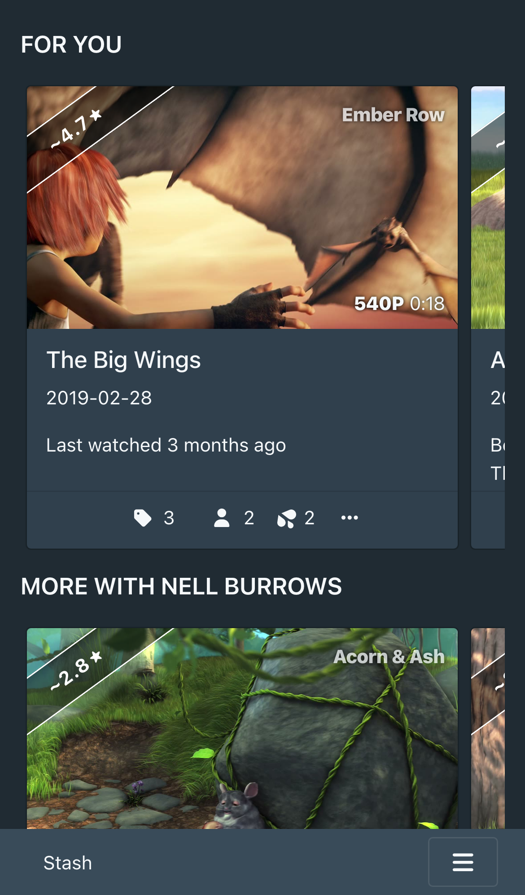

The screenshots show a demo library with invented names, cut from Blender Foundation open movies: Big Buck Bunny (© 2008 Blender Foundation, www.bigbuckbunny.org) and Sintel (© Blender Foundation, durian.blender.org) under [CC BY 3.0](https://creativecommons.org/licenses/by/3.0/), and Elephants Dream (© 2006 Blender Foundation and Netherlands Media Art Institute, www.elephantsdream.org) under [CC BY 2.5](https://creativecommons.org/licenses/by/2.5/).

## Made with AI

Cherry Pick was built with Claude, Anthropic's AI coding assistant, which wrote most of the code under the author's direction. The author set the design, iterated it on a mockup, and reviews the changes before each release. Commits that Claude helped write carry a `Co-Authored-By: Claude` line.

## Development

The repo's [README](../../README.md) covers building, testing and releasing. Cherry Pick's files:

- `src/CherryPick.yml` is the plugin manifest.
- `src/js/` holds ES modules and JSX that `plugin.mjs` bundles with esbuild into one `cherrypick.js`, compiled against Stash's own React. `model/` is the pure model (taste, For you, More like this, brackets), `runtime/` the store and Stash access, `storage/` the three places data lives, `features/` what each page gets, `ui/` the shared pieces.
- `src/css/` holds numbered partials, layout only.
- `docs/stash-seams.md` records where Cherry Pick hooks into Stash, checked against Stash's source.
- `tests/unit/` holds the model's unit tests, run by `pnpm test:unit`; `tests/demo-library.mjs` seeds the invented library the compatibility tests use.
- `tests/screenshots/` retakes the screenshots in `docs/screenshots/`: `blender-library.mjs` downloads the films, cuts the demo library from them and seeds a throwaway Stash, and `take-screenshots.mjs` takes each shot. Each script's header has its commands.

## License

AGPL-3.0, in this folder's [LICENSE](LICENSE), the license Stash itself uses.
